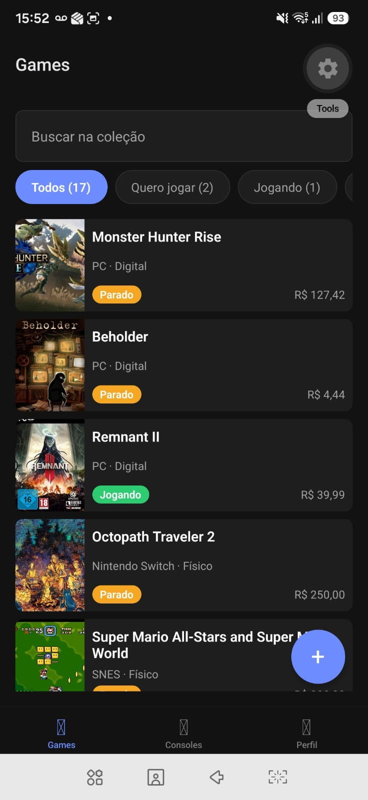
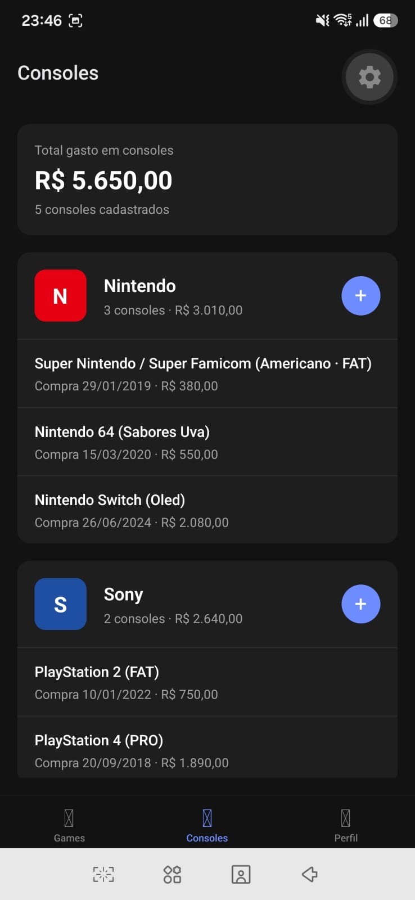
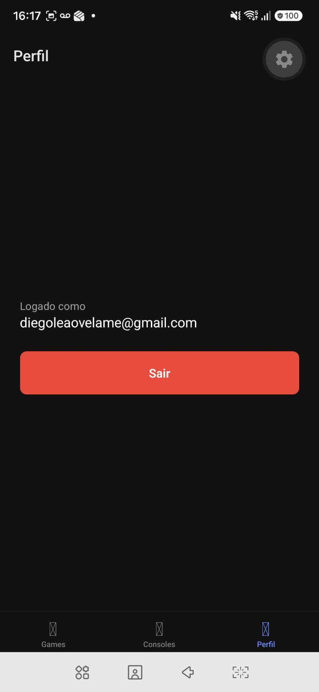

# Game Library (Gamebook)

**Instituição de Ensino:** Fatec Itu — Faculdade de Tecnologia de Itu  
**Curso:** Análise e Desenvolvimento de Sistemas (ADS) — 5º Semestre  

## 👥 Integrantes do Grupo
* Diego Leão
* Laura Marques

---

## 🔐 Credenciais de Acesso (Testes)

> Utilize as credenciais abaixo para acessar o ambiente de demonstração do aplicativo:

* **Usuário / E-mail:** `gamebookcollection@gmail.com`
* **Senha:** `12345678`

---

## 📱 Proposta do Projeto

O **Game Library** é um aplicativo móvel desenvolvido para entusiastas e colecionadores de videogames organizarem seu acervo pessoal de jogos e consoles em um só lugar. 

Com autenticação individual e banco de dados em nuvem, cada usuário possui sua própria conta isolada. O aplicativo permite catalogar jogos (físicos ou digitais), acompanhar o progresso de jogatina por status, registrar valores e datas de aquisição, além de gerenciar consoles organizados por fabricante — oferecendo uma visão consolidada do patrimônio e dos investimentos realizados na coleção.

---

## ✨ Principais Funcionalidades

* **Autenticação e Segurança:** Cadastro de novos usuários com nome de perfil, login persistente no dispositivo e isolamento total de dados por usuário.

* **Busca e Catálogo de Jogos:** Pesquisa integrada de títulos com carregamento automático de metadados (data de lançamento, gêneros e plataformas disponíveis) e busca inteligente por capas oficiais de caixa.

* **Gestão Completa da Coleção (CRUD):**
  * Adição de jogos definindo plataforma, formato (*Físico* ou *Digital*), status (*Quero jogar*, *Jogando*, *Parado* ou *Concluído*), loja, valor pago, data da compra e observações.
  * Atualização rápida de status diretamente na tela de detalhes, atualização sob demanda da arte de capa, edição completa dos registros e exclusão com confirmação.

* **Filtros Dinâmicos:** Filtragem da coleção em tempo real por status de progresso (com contador automático por categoria) e busca instantânea pelo título do jogo.

* **Gerenciamento de Consoles por Marca:** Organização do hardware em sete categorias de fabricantes (*Nintendo*, *Sony*, *Microsoft*, *Sega*, *Neo Geo*, *Steam* e *Atari*) com catálogo pré-definido de modelos, suporte a versões (*Slim*, *Pro*, *OLED*, etc.), edições especiais e cálculo automático de gastos por marca e no total.

* **Perfil e Métricas:** Visualização do resumo financeiro e estatístico da coleção (total investido em jogos e consoles e contagem de títulos por status).

---

## 🛠️ Tecnologias Utilizadas e Conceitos Explorados

### Stack Tecnológica
* **Front-end Mobile:** React Native com Expo e TypeScript
* **Navegação:** React Navigation (`Native Stack` e `Bottom Tabs`)
* **Back-end as a Service (BaaS):** Supabase (Authentication e Banco de Dados Relacional PostgreSQL)
* **Persistência Local:** AsyncStorage para manutenção da sessão autenticada

### Conceitos Explorados
* **Arquitetura em Camadas:** Separação clara de responsabilidades entre interfaces (`screens/`), componentes reutilizáveis (`components/`), gerenciamento de estado global (`contexts/`), regras de navegação (`navigation/`) e comunicação externa (`services/`).

* **Segurança em Banco de Dados:** Implementação de **Row Level Security (RLS)** no PostgreSQL para garantir que cada usuário leia, insira, atualize e exclua apenas seus próprios registros, além de **Triggers** e funções PL/pgSQL para criação automática de perfis e auditoria de atualização (`updated_at`).

* **Consumo Assíncrono de APIs e Resiliência:** Tratamento completo de estados de interface (*loading*, *empty*, *error* e sucesso), normalização de strings para cruzamento de dados entre APIs distintas e estratégia de *fallback* (plano B) caso um serviço secundário falhe.

* **Tipagem Estática e Utilitários:** Uso avançado de *Generics*, `Omit` e `Partial` em TypeScript, além de funções puras para máscaras de entrada, validação de datas e formatação monetária (`BRL`).

---

## 🌐 APIs Utilizadas

1. **RAWG Video Games Database API**  
   Utilizada para a pesquisa principal de jogos, obtenção de datas de lançamento, gêneros, plataformas suportadas e imagens promocionais de fallback.  
   🔗 Link: [https://rawg.io/apidocs](https://rawg.io/apidocs)

2. **TheGamesDB API**  
   Utilizada como serviço complementar para buscar e aplicar as capas oficiais de caixa (*boxart* frontal) correspondentes à plataforma selecionada pelo usuário.  
   🔗 Link: [https://api.thegamesdb.net/](https://api.thegamesdb.net/)

3. **Supabase REST / Auth API**  
   Responsável pela autenticação de usuários (JWT) e operações CRUD seguras no banco de dados PostgreSQL.  
   🔗 Link: [https://supabase.com/docs](https://supabase.com/docs)

---

## 📸 Capturas de Tela

| Tela de Login | Coleção de Jogos | Busca na RAWG |
| :---: | :---: | :---: |
|  |  |

| Detalhes do Jogo | Consoles por Marca | Perfil e Estatísticas |
| :---: | :---: | :---: |
|  |  |  |

---

## ⚙️ Como Executar o Projeto Localmente

1. **Clone o repositório:**
   ```bash
   git clone [https://github.com/diegolvf/GameBook](https://github.com/diegolvf/GameBook)
   cd game-library